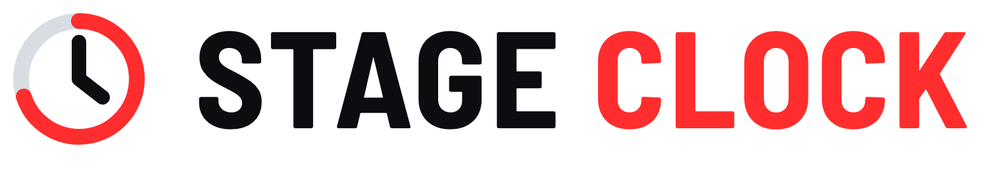
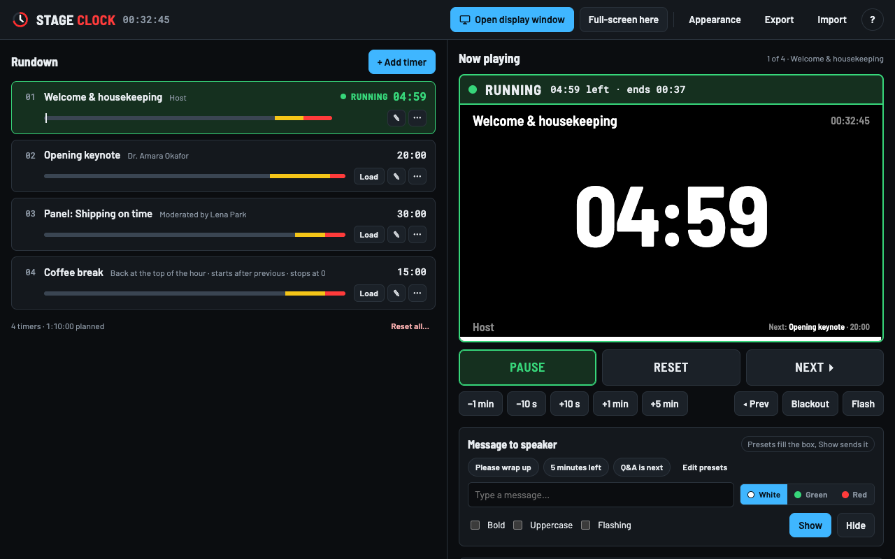
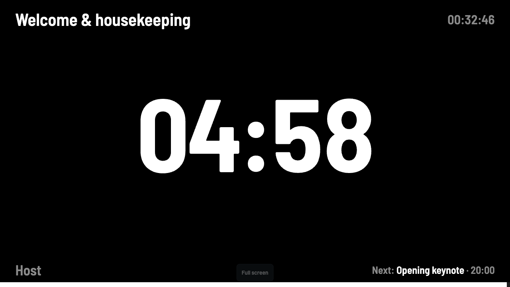

<p align="center">
  <picture>
    <source media="(prefers-color-scheme: dark)" srcset="docs/brand/logo-dark.png">
    
  </picture>
</p>

Free, open-source countdown timer for live events. Runs in the browser, installs as a Windows, macOS or Linux app, works offline. No account, no server, nothing leaves your machine.

All alerts are visual. The digits turn yellow, then red, then the screen flashes red with "TIME'S UP". No sound.




## Get it

- **Browser:** <https://david-uka.github.io/stage-clock/>
- **Windows, no download:** open the link above in Edge or Chrome and click the install icon in the address bar.
- **Installer / portable .exe, macOS, Linux:** [latest release](https://github.com/David-Uka/stage-clock/releases/latest)

The builds are not code-signed yet.
- **Windows:** if SmartScreen appears, click **More info → Run anyway**.
- **macOS:** right-click the app → **Open**, or allow it under **System Settings → Privacy & Security → Open Anyway**. If macOS says the app is "damaged", run `xattr -dr com.apple.quarantine "/Applications/Stage Clock.app"` once.

## Features

- One timer per speaker or segment, with title, speaker line, duration, count down or count up, overtime or stop at zero. Drag to reorder.
- Start each timer manually, when the previous one ends, or at a set time of day. Automatic starts fire even when the controller tab is in the background.
- Per-timer yellow and red warning times.
- Time's up: flash the screen red, solid red, blinking digits, or plain red digits. The text is editable.
- Speaker display in its own window for the projector, or fullscreen in the same tab.
- Start/pause, reset, next/previous, ±10 s and ±1 min while running, blackout, flash, messages to the speaker.
- All colors and fonts adjustable. JSON import/export. Saves automatically.

## Remote displays on the venue Wi-Fi

The desktop app runs a small local server. Open **Remote displays** in the controller, and any phone, tablet, laptop or Raspberry Pi on the same Wi-Fi can scan the QR code or open the link to show the speaker display. No internet needed. Windows may ask once to allow Stage Clock through the firewall; allow it for private networks.

## Remote displays anywhere with a room code

In **Remote displays**, click **Start a room**. The display device opens the link, scans the QR code, or opens <https://david-uka.github.io/stage-clock/?view=output&room=> and types the six-character code. Both ends need internet. The devices connect to each other directly over WebRTC; the public PeerJS service only introduces them and never sees the timer data.

## Remote displays through your own relay

If you would rather not depend on the public PeerJS service, deploy the relay in [`relay/`](relay/README.md) to Cloudflare Workers (free plan, about five minutes), paste its address into **Remote displays → Your own relay**, and click **Start relay room**. Displays open the link or scan the code, exactly like a room code.

## Shortcuts

| Key | Action |
| --- | --- |
| Space | Start / pause |
| R | Reset |
| N / P | Next / previous timer |
| ↑ / ↓ | ±1 minute (Shift: ±10 s) |
| F | Fullscreen display (Esc to leave) |
| B | Blackout |
| X | Flash |
| M | Message box |

## Run from source

The app is a single `index.html`, no build step.

```sh
git clone https://github.com/David-Uka/stage-clock
cd stage-clock
python3 -m http.server 8080
```

Desktop builds: `cd electron && npm install && npm run build:win` (or `build:mac`, `build:linux`). Pushing a `v*` tag builds all three on GitHub Actions and attaches them to a release.

## Contributing

See [CONTRIBUTING.md](CONTRIBUTING.md).

## License

[MIT](LICENSE)
